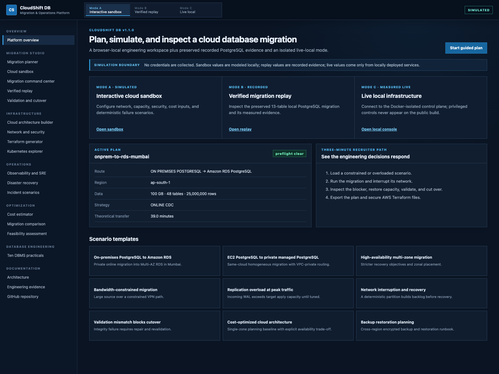
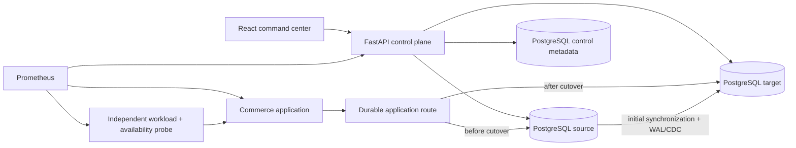

# CloudShift DB

[](https://github.com/gargparth2003/cloudshift-db/actions/workflows/ci.yml)
[](https://github.com/gargparth2003/cloudshift-db/actions/workflows/pages.yml)

CloudShift DB is an interactive cloud database migration and operations platform backed by a verified local
PostgreSQL migration engine. It combines planning, deterministic simulation, infrastructure/security design,
cost and reliability analysis, native logical replication, integrity checks, staged cutover, and preserved
operational evidence.

[Open Cloud Migration Studio](https://gargparth2003.github.io/cloudshift-db/platform/) ·
[Launch Verified Migration Replay](https://gargparth2003.github.io/cloudshift-db/replay/) ·
[Database Engineering Lab](https://gargparth2003.github.io/cloudshift-db/database-engineering-lab) ·
[Engineering evidence](docs/verification-matrix.md)

> Public v1.1 has explicit truth boundaries: cloud planning and failure exercises are **SIMULATED / ESTIMATED**;
> migration evidence is **RECORDED** from sanitized local synthetic runs; **MEASURED LIVE** controls remain
> loopback-only. The public site has no cloud credentials or infrastructure mutation path.



## The engineering problem

Database migration is not just copying rows. A credible migration must preserve committed transactions,
observe replication progress, detect divergence, establish a final consistency boundary, move application
traffic safely, protect the old primary, and leave evidence that can be audited after the event. CloudShift
DB implements that complete local vertical slice rather than simulating progress in the browser.

## Verified outcomes

| Observation | Verified local result |
|---|---:|
| PostgreSQL tables synchronized | 13 / 13 |
| Final-quiesced validation | 13,563 rows, 0 mismatches |
| Automated cutover workflow | 11 / 11 durable stages completed |
| Control write-fence duration | 424 ms |
| Independent request-failure window | 264 ms |
| Last source write → first target write | 1,089 ms at 250 ms probe precision |
| Subscription-free backup restore | 13 / 13 tables, 13,696 rows |
| Destination interruption recovery | 1,241 ms in one bounded local trial |
| Automated tests | 43 backend, 2 live browser, 5 deterministic domain, 10 backend-independent public |

These measurements come from one synthetic Apple Silicon run on 27 November 2026. The 424 ms fence,
264 ms request-failure window, and 1,089 ms write transition measure different boundaries. They are not
total migration duration, an SLA, a zero-downtime guarantee, or production capacity evidence.

## Architecture



- **Initial synchronization:** PostgreSQL subscription table copy moves the existing 13-table snapshot.
- **Continuous replication:** a logical replication slot streams committed WAL changes; rolled-back work
  remains absent from the target.
- **Transaction consistency:** commerce writes use database transactions and advisory locking around route
  changes. The cutover drains in-flight work before final validation.
- **Integrity:** bounded canonical row hashing compares counts and SHA-256 content; an intentional mismatch
  was detected, blocked, repaired, and revalidated.
- **Controlled cutover:** readiness, write fencing, drain, zero-lag observation, final validation, sequence
  synchronization, source protection, subscription transition, smoke testing, and route switching are durable.
- **Recovery and observability:** Prometheus metrics, incidents, workload operations, probe samples, backup
  reports, screenshots, and static replay evidence remain inspectable.

## Cloud migration studio

The v1.1 browser workspace includes a persistent ten-step planner, AWS/Azure/GCP terminology and region
mapping, nine engineering scenarios, a draggable architecture canvas, CIDR and security checks, a transparent
editable cost model, deterministic snapshot/CDC simulation, guarded validation and cutover, SRE/DR exercises,
an AWS Terraform generator, and a Kubernetes manifest explorer. Every calculation exposes its inputs and
formula; current provider rates are never fabricated. See the [v1.1 architecture](docs/architecture/cloud-platform-v1.1.md)
and [cloud readiness runbook](docs/runbooks/cloud-deployment-readiness.md).

## Quickstart

Prerequisites: Docker Engine with Compose and Make. Application runtimes are pinned inside ARM64-compatible
containers; the host Python and Node installations are not modified.

```sh
cp .env.example .env
make up
make health
make test
```

Open <http://127.0.0.1:18080/> and the live command center at
<http://127.0.0.1:18080/console/migration-command-center>. The API documentation is available at
<http://127.0.0.1:18000/api/docs>.

Useful checks:

```sh
make test-integration
make test-browser
make test-public
make benchmark
make build-public
```

The project uses the fixed Compose project name `cloudshift-parth`. An explicit reset requires
`make reset CONFIRM=cloudshift-parth` and removes only its containers, network, and eleven named volumes.
It never prunes Docker globally or touches unrelated projects.

## Database Engineering Lab

Ten optional executable practicals cover normalization, ACID/isolation, query optimization, sharding,
distributed query processing, Redis CRUD/caching, MongoDB documents, Prometheus time series, and Neo4j
dependency graphs. PostgreSQL remains the migration authority; heavyweight engines stay in isolated profiles.
See the [lab guide](docs/dbms-lab.md) and [syllabus mapping](docs/academic/syllabus-mapping.md).

## Cloud and delivery preparation

- Docker Compose is the verified local deployment baseline.
- Kubernetes manifests render successfully but have not been deployed to a cluster.
- Terraform 1.17.2 with AWS provider 6.74.0 validates, but no plan/apply or paid AWS resource was created.
- GitHub Actions build and test the frontend, backend, Compose integration, infrastructure, browser replay,
  and secret scan. Pages deploys only the static read-only demonstration.

## Evidence and limitations

- [Project status](PROJECT_STATUS.md)
- [Verification matrix](docs/verification-matrix.md)
- [Performance evidence](docs/benchmarks.md)
- [Interview guide](docs/interview-guide.md)
- [Portfolio summary](docs/portfolio-summary.md)
- [Security model](SECURITY.md)

Authentication is a local static operator token. WAL archiving/PITR, production HA, automatic schema
evolution, reverse replication, post-cutover slot retirement, and a statistically controlled benchmark
matrix remain future work. Infrastructure configuration is not evidence of a production deployment.

## Developer

Designed and developed by **Parth Garg** as an M.E. Computer Science and Engineering — Cloud Computing
database reliability and cloud engineering project.

MIT licensed. See [LICENSE](LICENSE).
