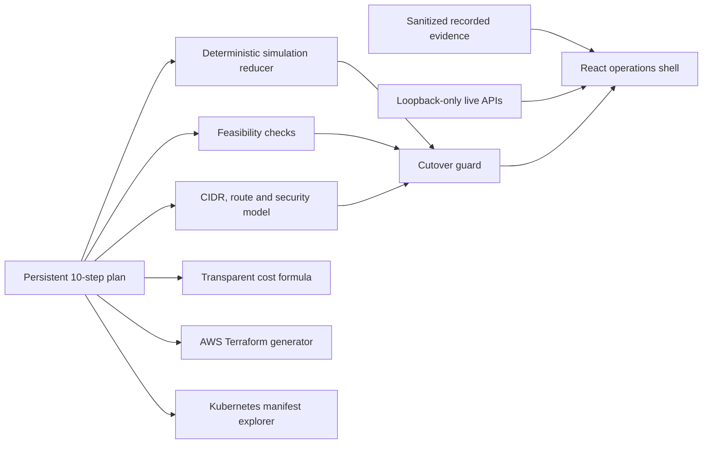

# CloudShift DB v1.1 cloud platform

CloudShift DB v1.1 adds a browser-local cloud migration and operations workspace without weakening the
verified v1.0 data-plane evidence. The public application has three deliberately separate truth modes:

| Mode | Label | Data authority | Permitted behavior |
|---|---|---|---|
| Interactive sandbox | `SIMULATED` / `ESTIMATED` | Deterministic browser state | Edit plans, run modeled migrations and failures, export artifacts |
| Verified replay | `RECORDED` | Sanitized v1.0 local evidence | Inspect and replay; no mutation path |
| Live local | `MEASURED LIVE` | Project-scoped Compose APIs | Observe and operate the authorized local stack with runtime credentials |

No public route accepts a cloud credential, contacts a provider API, or executes Terraform or Kubernetes.
Local storage contains only the user's browser plan and editable estimate inputs.

## Browser architecture

The simulation reducer is deterministic: the same configuration and action sequence produces the same
state. Each tick bounds elapsed time, copied bytes, and backlog at zero or above. Incoming WAL above target
apply capacity grows backlog; pause and network partition stop forward progress; validation mismatch and
uncleared preflight failures block modeled cutover. The event log is capped to prevent unbounded memory use.

## Provider terminology and scope

The planner maps AWS, Azure, and Google Cloud terms so architecture comparisons remain legible. Region
catalogs and managed PostgreSQL prerequisite guidance link to official provider documentation. Generated
deployment code is AWS-first: selecting Azure or Google Cloud produces an explicit unsupported artifact
instead of invented infrastructure. Estimate rates start at zero and must be entered by the user after
consulting the linked official calculators.

## Route delivery

The public build emits an `index.html` for every documented route in addition to the GitHub Pages fallback.
This makes direct navigation and refresh return a successful static response instead of depending only on a
404-based SPA workaround. Playwright blocks backend URLs and verifies the planner, simulation, network,
FinOps, Terraform, replay, mobile layout, and direct route behavior.

## Boundaries

- Modeled timing and cost are not provider measurements or quotes.
- Configuration validation is not cloud deployment evidence.
- Kubernetes YAML is generated and rendered, not applied to a cluster.
- The verified replay remains the source for historical local migration measurements.
- The live mode remains loopback-only and is never hosted on GitHub Pages.
