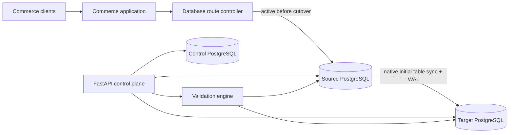

# System Architecture

CloudShift DB uses a local-first modular monolith around PostgreSQL native logical replication.

The source and target are independent PostgreSQL clusters. Platform metadata is never stored with commerce data. PostgreSQL native logical replication is selected because it coordinates the table copy with the replication start position and preserves committed transaction application semantics more defensibly than an independently implemented snapshot and change reader.

The source application remains authoritative until a final write fence, replication catch-up, consistency-bound validation, sequence synchronization, and target smoke test complete. Post-cutover rollback is blocked unless a tested reverse synchronization path exists.

## Local resource boundaries

All published ports bind to `127.0.0.1`. The Compose project name is `cloudshift-parth`; its network and volumes carry matching names and labels. No service mounts the Docker socket. The configured upper bounds are 2.25 GiB across the databases, 384 MiB for the control plane, 256 MiB for commerce, and 128 MiB for the console. Actual sampled usage after cutover was approximately 204 MiB across all six services.

After the verified cutover, application traffic is routed to the target, source application DML is revoked, and the forward subscription is disabled. The retained slot is observable but requires an explicit retirement policy.
