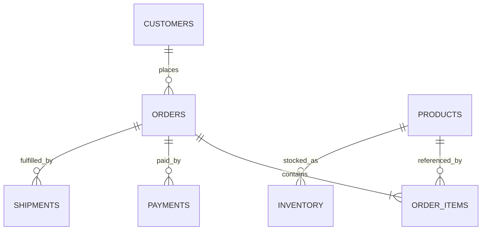

# Database Engineering Lab

The lab is deliberately separate from the recruiter-facing migration workflow. Every result below is a
local synthetic observation stored under `artifacts/labs`; none is a production benchmark.

## 1. Normalization and denormalization

Objective: inspect the normalized commerce schema and compare a join aggregate with
`commerce.product_sales_summary`. The schema demonstrates scalar 1NF values, separated order-item
dependencies for 2NF, separated customer/product/payment/shipment facts for 3NF, and declared candidate
keys relevant to BCNF. Business dependencies not encoded as constraints remain an application concern.



The executable experiment records relation sizes and `EXPLAIN (ANALYZE, BUFFERS, FORMAT JSON)` for the
normalized and refreshed materialized representation. Denormalization reduces repeated aggregation work
but introduces refresh cost and staleness risk.

## 2. ACID and isolation

The experiment uses independent psycopg sessions. It verifies rollback atomicity, a non-negative balance
constraint, commit durability through a new connection, READ COMMITTED visibility, REPEATABLE READ
snapshot stability, serializable write-skew protection, and row-lock blocking. The observed serializable
outcomes were one commit and one `SerializationFailure`; measured lock blocking was 512.65 ms.
PostgreSQL maps READ UNCOMMITTED to READ COMMITTED, so unsupported anomaly claims are intentionally absent.

## 3. B-tree and hash indexing

A bounded 100,000-row probe table is queried before and after index creation. The observed access path
changed from `Seq Scan` to `Index Scan` for both B-tree and hash equality indexes; a composite
`(bucket, probe_id)` query is also measured. Index sizes, buffers, planning time, and execution time are
stored in the artifact. PostgreSQL bitmap scans are runtime access paths, not a separately implemented
persistent bitmap index.

Run or reset practicals 1–3:

```sh
make lab-postgres
make lab-postgres-reset
```

## 4. Distributed sharding

Three independent PostgreSQL services store NORTH, SOUTH, and WEST customers. `region_code` is the shard
key and an enforced check constraint prevents misplaced rows. Each shard contains 1,000 rows; the merged
observation contains 3,000. There is no cross-shard atomic transaction coordinator.

## 5. Distributed query processing

The runner decomposes a count/sum aggregate, dispatches it to each physical shard, and merges identical
partial results. One warm local trial measured 175.241 ms sequential and 67.808 ms parallel wall time;
Docker/process overhead dominates this small dataset, so the figures are not capacity evidence.

```sh
make lab-shards
docker compose --project-name cloudshift-parth --profile distributed stop shard-north shard-south shard-west
```

An explicit project reset removes the three shard volumes.

## 6. Redis key-value CRUD

The optional authenticated Redis profile executes `SET`, `GET`, TTL-preserving update, `TTL`, and `DEL`,
recording subprocess-inclusive latency and returned values. No public administrative command API exists.

## 7. MongoDB document queries

The optional MongoDB profile stores three synthetic diagnostic documents. The executable script verifies
document insertion, nested-field filters, severity grouping, average recovery aggregation, and a nested
WAL evidence query. PostgreSQL remains the durable migration authority.

## 8. Redis caching

The route cache experiment starts with a miss, reads the authoritative PostgreSQL route, populates a
30-second Redis entry, observes a hit, invalidates it, and confirms the subsequent miss. The one local
subprocess-inclusive timing sample is not a statistically meaningful cached/uncached benchmark.

```sh
make lab-redis
make lab-mongo
```

Rerunning Redis deletes its bounded lab keys; rerunning MongoDB deletes only documents tagged
`lab_run=practical7` before recreating them.

## 9. Time-series database

The Prometheus practical executes instant queries for scrape health, database availability, workload
counters/rates, WAL lag, and validation duration, plus a one-hour/30-second-step range query. It explains
counter versus gauge semantics and stores the actual response. Retention is intentionally six hours.

```sh
make observability-up
make lab-prometheus
```

## 10. Graph database

The optional Neo4j profile models an application, three databases, a schema, four tables, migration and
foreign-key dependencies. The verified graph has 9 nodes and 12 relationships. Cypher queries return the
source-to-target migration path, reachable tables, and customer dependency impact. Rerunning deletes only
nodes tagged `labRun=practical10`.

```sh
make lab-graph
```

The graph is a curated subset for dependency-analysis education, not a production catalog.

## Additional distributed topics

The sharding lab demonstrates data partitioning/localization and an eventual multi-node query merge, but
does not constitute a CAP partition experiment because no replicated service is deliberately partitioned.
Strong consistency is used inside each PostgreSQL transaction; PostgreSQL logical replication is
asynchronous and therefore target visibility is eventual before the cutover boundary. Column-family and
NewSQL systems remain conceptual extensions; a heavyweight CockroachDB or Cassandra cluster is not added
solely for terminology.
